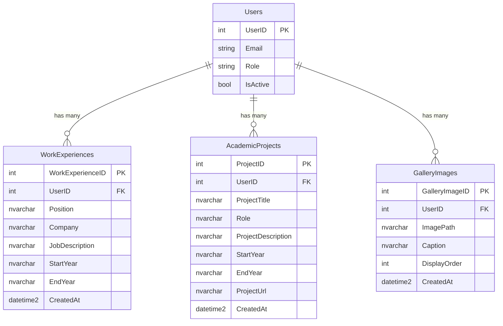

# 25 - Database Schema & Migration Guide: Work Experience, Academic Projects & Gallery

## Overview
This guide provides the complete database schema and step-by-step instructions for adding:
1. **Work Experience** (Company, Position, Job Description, Start Year, End Year)
2. **Academic Projects** (Project Title, Role, Description, Start Year, End Year, Project Link)
3. **Gallery** (Image carousel collection with Image Path, Caption, and Display Order)

The migration file is saved in:
[`Backend/Database/Migration/03_Add_WorkExperience_Projects_Gallery.sql`](file:///c:/Martin%20Archive/Programming/ASP%20NET/241611JalopPersonalWebsite/241611JalopPersonalWebsite/Backend/Database/Migration/03_Add_WorkExperience_Projects_Gallery.sql)

---

## 1. Relational Schema Architecture

All three tables follow the project's standard 1-to-many relationship with `dbo.Users`:
- `UserID` is a Foreign Key referencing `dbo.Users(UserID)` with `ON DELETE CASCADE`.
- Each table includes an index on `UserID` for fast indexed query lookups.
- Safe re-runnable (idempotent) syntax checking `IF OBJECT_ID(...) IS NULL`.

---

## 2. Table Specifications

### A. `dbo.WorkExperiences`
| Column | Type | Nullable | Description |
| :--- | :--- | :---: | :--- |
| `WorkExperienceID` | `INT IDENTITY(1,1)` | No (PK) | Primary unique identifier |
| `UserID` | `INT` | No (FK) | Reference to `dbo.Users(UserID)` |
| `Position` | `NVARCHAR(100)` | No | Job title / designation (e.g. *Junior Software Engineer*) |
| `Company` | `NVARCHAR(150)` | No | Company or employer name |
| `JobDescription` | `NVARCHAR(MAX)` | Yes | Responsibilities, achievements, and technologies |
| `StartYear` | `NVARCHAR(10)` | No | Year or period started (e.g. `2022`) |
| `EndYear` | `NVARCHAR(10)` | Yes | Year completed or `Present` for current roles |
| `CreatedAt` | `DATETIME2` | No | Timestamp of creation (defaults to `SYSUTCDATETIME()`) |

### B. `dbo.AcademicProjects`
| Column | Type | Nullable | Description |
| :--- | :--- | :---: | :--- |
| `ProjectID` | `INT IDENTITY(1,1)` | No (PK) | Primary unique identifier |
| `UserID` | `INT` | No (FK) | Reference to `dbo.Users(UserID)` |
| `ProjectTitle` | `NVARCHAR(150)` | No | Name or title of the academic project |
| `Role` | `NVARCHAR(100)` | No | Individual role (e.g. *Lead Developer*, *Fullstack Dev*) |
| `ProjectDescription` | `NVARCHAR(MAX)` | Yes | Summary of project objectives and tech stack |
| `StartYear` | `NVARCHAR(10)` | No | Year started (e.g. `2023`) |
| `EndYear` | `NVARCHAR(10)` | Yes | Year completed or `Present` |
| `ProjectUrl` | `NVARCHAR(500)` | Yes | Optional link to GitHub repository, live demo, or paper |
| `CreatedAt` | `DATETIME2` | No | Timestamp of creation (defaults to `SYSUTCDATETIME()`) |

### C. `dbo.GalleryImages` (Carousel)
| Column | Type | Nullable | Description |
| :--- | :--- | :---: | :--- |
| `GalleryImageID` | `INT IDENTITY(1,1)` | No (PK) | Primary unique identifier |
| `UserID` | `INT` | No (FK) | Reference to `dbo.Users(UserID)` |
| `ImagePath` | `NVARCHAR(500)` | No | Relative path or URL (e.g. `~/Uploads/Gallery/proj1.png`) |
| `Caption` | `NVARCHAR(255)` | Yes | Title, caption, or description overlay for the slide |
| `DisplayOrder` | `INT` | No | Sequence index (0, 1, 2...) for carousel ordering |
| `CreatedAt` | `DATETIME2` | No | Timestamp of creation (defaults to `SYSUTCDATETIME()`) |

---

## 3. Apply the ordered migration manifest

Create or select the intended application database using your database host's tools. Configure its connection in the operator process through SQLCONNSTR_DefaultConnection, then run Tools/InitializeDatabase.ps1 from the repository root. Keep credentials out of committed documentation and command examples.

The single manifest at 241611JalopPersonalWebsite/Backend/Database/Migration/manifest.txt defines the supported order: base schema, profile/section additions, visibility column, stored procedures, then work experience/projects/gallery tables. Legacy numeric filename prefixes alone do not define execution order.

Every script uses the selected connection database; none creates or switches to a hardcoded database. The installer refuses system databases and wraps the manifest in a transaction. Existing rows are preserved on rerun; back up existing data before applying schema changes.

After a fresh installation, use Tools/InitializeAdministrator.ps1 to supply the first administrator's credentials. Existing installations keep their current accounts and do not run first-admin setup. See the repository README for the current setup and deployment instructions.
